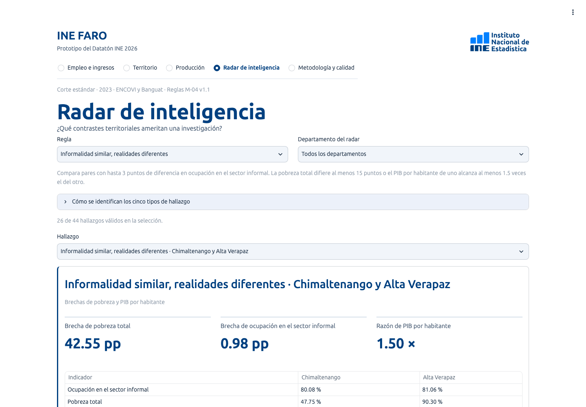
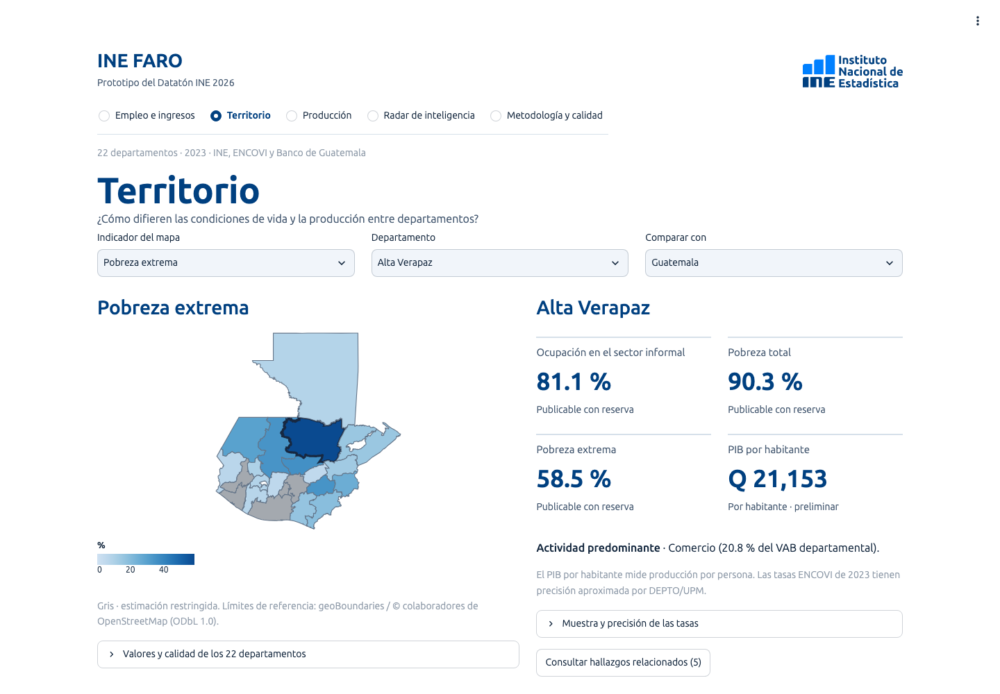
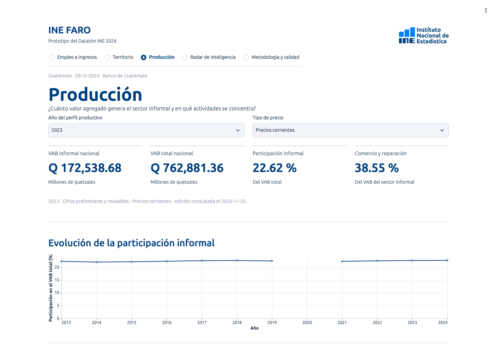
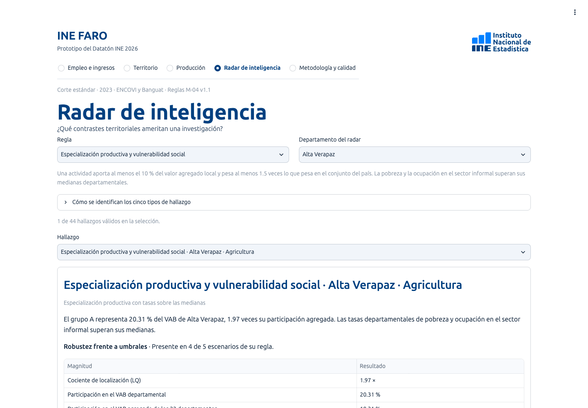
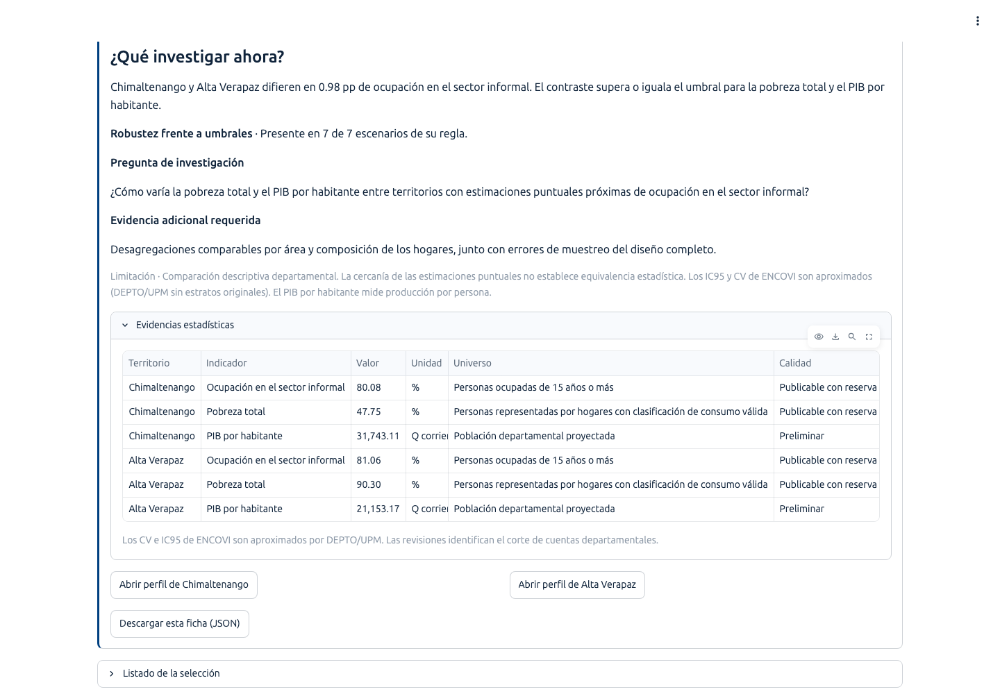
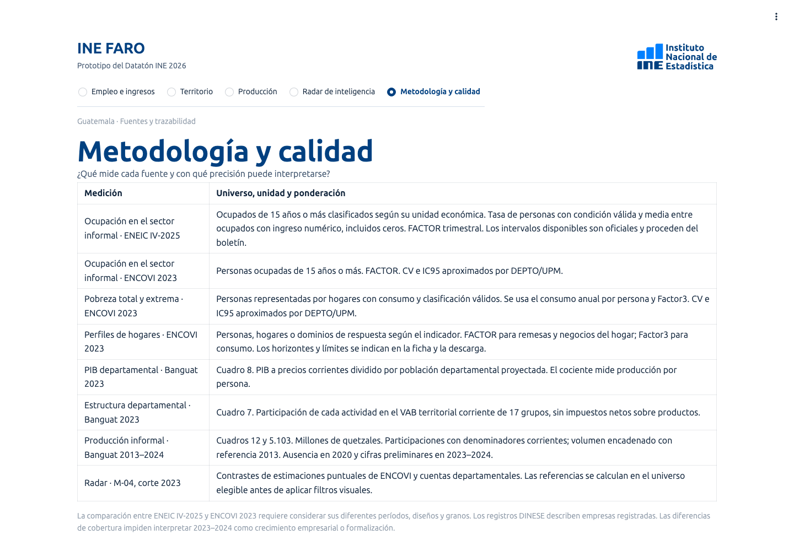
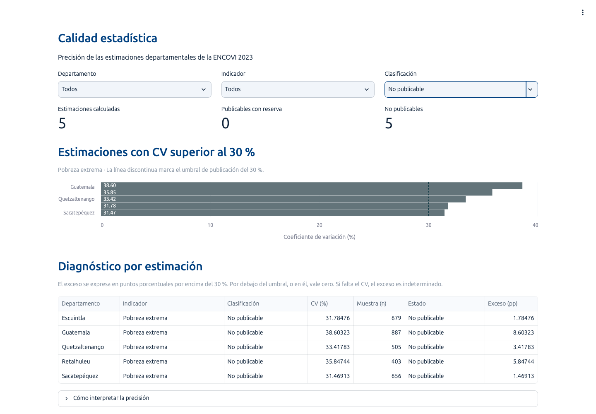
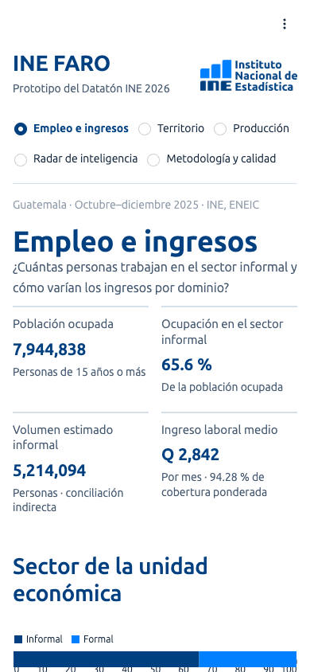
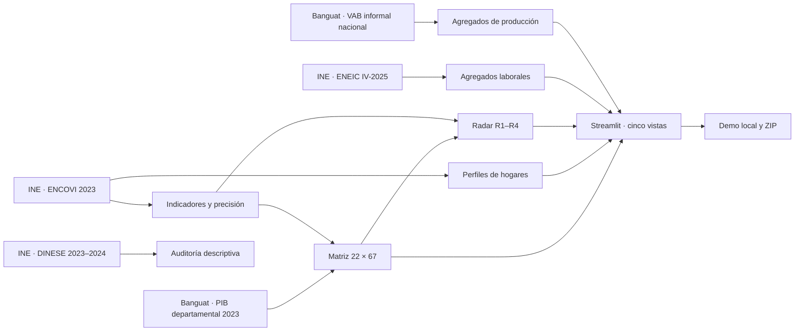

<h1 align="center">INE FARO</h1>
<p align="center"><strong>Inteligencia estadística y territorial para Guatemala</strong><br>Datatón INE 2026 · Prototipo v1.1</p>
<p align="center"><a href="https://ine-faro.streamlit.app/"><strong>Abrir demo principal</strong></a> · <a href="https://ine-faro.onrender.com/">Demo de respaldo</a> · <a href="https://youtu.be/GJHaQwxRxqs"><strong>Video demostrativo</strong></a> · <a href="presentacion.pdf">Presentación</a> · <a href="docs/entrega/README.md">Expediente técnico</a></p>

> ¿Qué no sabemos todavía sobre Guatemala? Los datos ya están ahí. Solo falta hacerles las preguntas correctas.

> [!NOTE]
> **Para el jurado:** comenzar por la [demo principal en Streamlit](https://ine-faro.streamlit.app/). Si no responde, intentar el [respaldo en Render](https://ine-faro.onrender.com/) o descargar el [ZIP autónomo del corte validado](https://raw.githubusercontent.com/A625A/INE-FARO/63af665b30b567c662b8098946595e2df4ab0c9e/docs/evidencia/entrega/INE-FARO-Dataton.zip). Los servicios alojados pueden requerir tiempo de arranque. El ZIP funciona sin internet después de instalar dependencias. El [guion](docs/guion_demo.md), la [presentación](presentacion.pdf) y la [guía local](docs/entrega/reproduccion.md) permiten seguir el caso incluso sin acceso a los servicios web.

## El problema

Guatemala cuenta con fuentes oficiales que describen la ocupación, las condiciones de vida y la producción. Sin embargo, comparar sus resultados requiere respetar períodos, universos, ponderadores, denominadores y precisión estadística. Una tasa aislada no necesariamente permite entender los contrastes entre territorios.

INE FARO reúne estos indicadores y propone preguntas de investigación mediante un radar de reglas transparentes. El tablero es la interfaz; el radar es el mecanismo de descubrimiento. Su propósito es complementar el trabajo de los analistas del INE, no reemplazar su juicio ni producir nuevas estadísticas oficiales.

## Caso de uso

**¿Qué podemos investigar cuando dos departamentos tienen tasas cercanas de ocupación en el sector informal, pero niveles de pobreza muy distintos?**

| ENCOVI 2023 | Chimaltenango | Alta Verapaz | Brecha absoluta |
|---|---:|---:|---:|
| Ocupación en el sector informal, población ocupada de 15 años o más | 80.08 % | 81.06 % | 0.98 pp |
| Pobreza total de personas | 47.75 % | 90.30 % | 42.55 pp |

Las cuatro estimaciones se publican con reserva e intervalos aproximados. pp = puntos porcentuales.

1. En **Empleo e ingresos**, seleccionar **Ver contraste Chimaltenango–Alta Verapaz**.
2. Examinar la ficha R1:2023:04-16, sus magnitudes, evidencia, precisión y sensibilidad.
3. Seleccionar **Abrir comparación en Territorio** para inspeccionar ambos departamentos.
4. Formular una nueva investigación: ¿cuánto de la brecha de pobreza persiste al comparar por separado áreas urbanas y rurales con suficiente soporte muestral?

<p align="center"></p>

El contraste aparece en los siete escenarios R1 evaluados. Esta persistencia se refiere únicamente a los umbrales explorados; no demuestra causalidad ni equivalencia estadística. [Caso completo](docs/caso_demostracion.md) · [Reglas del radar](docs/reglas_radar.md).

## Aplicabilidad institucional

INE FARO está diseñado para complementar el trabajo de los analistas del INE, facilitando la identificación de contrastes territoriales y la priorización de nuevas investigaciones. Por ejemplo, un analista que prepara un boletín territorial puede utilizar el contraste Chimaltenango–Alta Verapaz para decidir si conviene estudiar la brecha de pobreza por área urbana y rural, siempre que exista soporte muestral suficiente.

- **Adopción:** interfaz interactiva que permite explorar indicadores, revisar evidencia y descargar hallazgos sin necesidad de conocimientos de programación.
- **Mantenimiento:** ante una nueva publicación estadística, el equipo técnico podría revisar los cambios de estructura y metodología, ejecutar los productores documentados, validar los agregados y las reglas, y publicar el nuevo corte tras su revisión.
- **Escalabilidad:** el procesamiento modular y la separación entre datos, radar e interfaz facilitan incorporar nuevos indicadores, fuentes y reglas. Cada ampliación requiere revisar la compatibilidad estadística y técnica; no se ha probado el escalamiento a otros niveles territoriales.
- **Implementación:** tecnologías de código abierto, ejecución local y despliegue web sin necesidad de contratar servicios de inteligencia artificial. Un despliegue institucional requeriría definir responsables, infraestructura y un procedimiento de actualización.
- **Protección de datos:** la aplicación consume resultados agregados y no requiere exponer microdatos durante su funcionamiento; conserva las restricciones de precisión en las vistas y exportaciones correspondientes.

FARO no pretende sustituir el criterio del investigador, sino facilitar el proceso de descubrir, verificar y formular nuevas preguntas sobre Guatemala. Estas posibilidades de adopción y mantenimiento son una propuesta institucional, no una implementación ya aprobada por el INE.

## Funcionalidades

| Vista | Qué permite hacer |
|---|---|
| **Empleo e ingresos** | Explorar ENEIC IV-2025: ocupación, sector informal, ingreso laboral medio y dominios geográficos. La composición por rama describe a todos los ocupados. |
| **Territorio** | Explorar 22 departamentos, cambiar indicadores en el mapa, comparar territorios y consultar perfiles de hogares, remesas, negocios y consumo. |
| **Producción** | Consultar VAB informal nacional, evolución temporal, composición y participaciones por actividad económica. |
| **Radar de inteligencia** | Filtrar 44 hallazgos por regla o departamento, inspeccionar evidencia y sensibilidad, consultar preguntas de investigación y descargar resultados. |
| **Metodología y calidad** | Revisar fuentes, denominadores, precisión, intervalos disponibles y restricciones de publicación. |

<details open>
<summary><strong>Territorio · mapa y comparación departamental</strong></summary>
<p align="center"></p>
</details>
<details>
<summary><strong>Producción · evolución y estructura económica</strong></summary>
<p align="center"></p>
</details>
<details>
<summary><strong>Radar · hallazgos y preguntas</strong></summary>
<p align="center"></p>
<p align="center"></p>
</details>
<details>
<summary><strong>Metodología y calidad · precisión y restricciones</strong></summary>
<p align="center"></p>
<p align="center"></p>
</details>
<details>
<summary><strong>Vista móvil</strong></summary>
<p align="center"></p>
</details>

Capturas del prototipo v1.1. [Evidencia visual](docs/evidencia/M-05/final/) · [Implementación](docs/M05_IMPLEMENTACION.md).

## Arquitectura

El procesamiento se ejecuta por fuente y la aplicación consume los agregados versionados. El radar usa reglas deterministas, no un LLM ni un modelo predictivo.



| Fuente | Uso en el proyecto |
|---|---|
| ENCOVI 2023 | Ocupación en el sector informal, pobreza, precisión y perfiles de hogares. |
| ENEIC IV-2025 | Indicadores laborales nacionales y por dominio; 21 celdas públicas. |
| Banguat | PIB departamental 2023 y VAB informal nacional 2013–2019, 2021–2024. |
| DINESE 2023–2024 | Auditoría descriptiva de registros empresariales; no alimenta el radar. |

**Stack:** Python, Pandas, NumPy, Streamlit, Altair, CSV, JSON, GeoJSON, Pytest y Playwright. No requiere credenciales ni servicios externos para la demo local. [Arquitectura y contratos](docs/entrega/arquitectura.md) · [Inventario de fuentes](docs/fuentes.csv) · [Contratos de datos](docs/CONTRATOS_DE_DATOS.md).

## Validación

La evidencia corresponde al [corte técnico validado 63af665](https://github.com/A625A/INE-FARO/commit/63af665b30b567c662b8098946595e2df4ab0c9e), no a una medición en producción ni a una calificación oficial del jurado.

| Control | Resultado registrado |
|---|---|
| Matriz territorial | 22 departamentos × 67 columnas |
| Radar | 44 fichas en cuatro familias de reglas; 21 escenarios de sensibilidad |
| Precisión ENCOVI departamental | 66 estimaciones; 61 publicables según el criterio del proyecto, cinco restringidas |
| Perfiles de hogares | 207 celdas; 14 restringidas |
| Pruebas de software | 231 aprobadas |
| Recorrido Chromium | Escritorio y móvil emulado; cero errores de consola y cero solicitudes externas durante el ensayo local |
| Paquete de entrega | 58 archivos regulares; dos empaquetados idénticos en el entorno de referencia |

Se suprimen los valores e intervalos de las estimaciones restringidas en las vistas y exportaciones públicas correspondientes. Las pruebas de software verifican comportamiento, contratos y conciliaciones; no sustituyen la validación estadística. [Registro de validación](docs/evidencia/entrega/VALIDACION.md) · [Informe de navegador](docs/evidencia/entrega/chromium.txt) · [Evaluación del radar](docs/evaluation/radar_evaluation.md) · [Revisión de aceptación](docs/revision_final.md).

## Ejecutar la demostración

**Requisitos:** Python 3.14 (corte verificado con 3.14.3), Git si se clona el repositorio e internet para instalar dependencias por primera vez. No se necesitan los microdatos originales para abrir la demo.

### Opción A · ZIP autónomo (recomendada para el jurado)

[Descargar INE-FARO-Dataton.zip](https://raw.githubusercontent.com/A625A/INE-FARO/63af665b30b567c662b8098946595e2df4ab0c9e/docs/evidencia/entrega/INE-FARO-Dataton.zip). Extraerlo en una carpeta nueva y abrir la terminal donde se encuentra `app.py`.

### Opción B · Clonar el repositorio

```sh
git clone https://github.com/A625A/INE-FARO.git
cd INE-FARO
```

Si se necesita una referencia técnica inmutable, usar `git checkout --detach 63af665b30b567c662b8098946595e2df4ab0c9e` en una copia de trabajo.

### macOS / Linux

Desde la carpeta de la opción A o B, con Python 3.14 instalado:

```sh
python3.14 -m venv .venv
source .venv/bin/activate
python -m pip install -r requirements.txt
python -m pip check
python -m streamlit run app.py
```

### Windows (PowerShell)

```powershell
py -3.14 -m venv .venv
.\.venv\Scripts\python.exe -m pip install -r requirements.txt
.\.venv\Scripts\python.exe -m pip check
.\.venv\Scripts\python.exe -m streamlit run app.py
```

Abrir [http://localhost:8501](http://localhost:8501). La aplicación inicia en **Empleo e ingresos**. Para detenerla, presionar Ctrl+C. La secuencia Windows está documentada; su ejecución en Windows nativo queda pendiente.

Si el puerto está ocupado, añadir `--server.port 8516` y abrir el nuevo puerto. Si la aplicación falla, comprobar que la terminal esté en la carpeta de `app.py` y que `pip check` termine sin errores. Consultar la [guía de reproducción y solución de problemas](docs/entrega/reproduccion.md).

## Reproducir los resultados

La demo utiliza agregados ya preparados. Para recalcularlos, se necesitan los microdatos ENCOVI, los cuadros de PIB departamental y los registros DINESE versionados, además de los seis insumos originales de ENEIC y VAB nacional.

La [guía de reproducción](docs/entrega/reproduccion.md) contiene las rutas, huellas SHA-256, instrucciones de descarga, secuencia completa del pipeline, reconstrucción del ZIP y prueba de navegador. Para ENEIC, el comando `python scripts/procesar_eneic.py --download` recupera y valida los insumos; para VAB nacional, seguir el [contrato de fuentes](docs/VAB_CONTRATO_M05.md).

Una vez reconstruidos los datos según la guía, desde la raíz del repositorio y con el entorno activo:

```sh
python docs/evaluation/m05_final/validar_consumo.py
python -m pytest -p no:cacheprovider -q
```

Para comprobar la integridad del paquete y la presentación en macOS/Linux:

```sh
shasum -a 256 -c docs/evidencia/entrega/SHA256SUMS
```

En Windows, usar `Get-FileHash -Algorithm SHA256` y comparar con el [registro de huellas](docs/evidencia/entrega/SHA256SUMS).

## Cautelas científicas

- El indicador territorial corresponde a ocupación en el **sector informal**, no a toda forma de empleo informal. ENCOVI 2023 y ENEIC IV-2025 tienen períodos y universos distintos.
- La pobreza de ENCOVI se mide a partir del consumo; PIB por habitante no equivale a ingreso de los hogares. VAB no equivale a PIB.
- Los volúmenes encadenados no son necesariamente aditivos. La serie nacional de VAB informal conserva la ausencia de 2020.
- Los intervalos ENCOVI son aproximados por las limitaciones del diseño muestral disponible. Los valores restringidos no deben interpretarse como cero.
- El radar formula preguntas descriptivas; su sensibilidad no implica causalidad, significancia estadística ni equivalencia entre territorios.
- DINESE describe registros de empresas; no permite concluir creación empresarial o formalización laboral.

[Metodología](docs/metodologia.md) · [Diagnósticos y precisión](docs/M01_IMPLEMENTACION.md).

## Entrega y documentación

| Recurso | Enlace |
|---|---|
| Video demostrativo | [Ver en YouTube](https://youtu.be/GJHaQwxRxqs) |
| Paquete local | [ZIP validado](docs/evidencia/entrega/INE-FARO-Dataton.zip) |
| Presentación | [PDF de cinco diapositivas](presentacion.pdf) |
| Dossier | [Expediente técnico](docs/entrega/README.md) |
| Reproducción | [Instalación y pruebas](docs/entrega/reproduccion.md) |

### Fuentes y condiciones de uso

[INE](https://www.ine.gob.gt/) · [Banco de Guatemala: cuadros departamentales](https://banguat.gob.gt/page/cuadros-estadisticos-por-departamento-2013-2024) · [DINESE](https://datos.ine.gob.gt/dataset/directorio-nacional-estadistico-de-empresas-dinese).

El prototipo utiliza tecnologías de código abierto y su código está disponible públicamente. El repositorio no declara una licencia general. Los datos y recursos conservan las condiciones de sus fuentes; consultar las [atribuciones y condiciones de terceros](THIRD_PARTY_NOTICES.md) y el [inventario de fuentes](docs/fuentes.csv).
