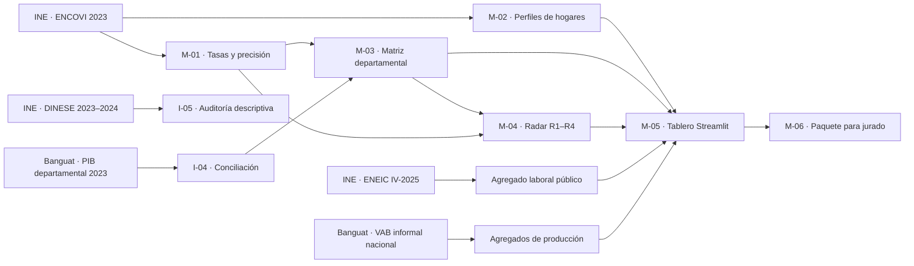

# Arquitectura, datos y reglas de INE FARO v1.1
INE FARO tiene productores por fuente, una matriz departamental, un motor de reglas y una aplicación Streamlit. Los productores se ejecutan por comando para reconstruir el corte. La demo lee solo los agregados y recursos incluidos en el ZIP. El navegador se comunica con Streamlit en el mismo equipo durante la demo. [Implementación M-05](../M05_IMPLEMENTACION.md)

## Fuentes y preparación

| Fuente fijada | Grano de entrada y controles | Producto que deja |
| --- | --- | --- |
| INE · ENCOVI 2023 | Microdatos en formato SPSS (`.sav`) de Personas, Hogares, Agregado.Consumo, Negocios.1 y Negocios.2. `NO_HOGAR` identifica hogares, `NO_HOGAR + CP` personas y `NO_HOGAR + ID_NEGOCIO` el detalle de negocios. I-02 verifica unicidad, diccionarios y cardinalidad. | Tasas y perfiles de M-01 y M-02. [Inventario de bases y llaves](../exploracion_encovi_resumen.md) |
| Banguat · PIB departamental | XLSX de PIB total, resultados por actividad y PIB por habitante. I-04 coteja el año y los 22 departamentos, separa tipos de precio y conserva el control extrarregional y nacional fuera del mapa. | `pib_departamental.csv`, `pib_per_capita.csv` y `pib_conciliacion.csv`. [Metadatos](../metadata_pib.md) |
| INE · ENEIC IV-2025 | XLSX de Personas y diccionario, con el boletín. La clave de origen es `ANIO, TRIMESTRE, DOMINIO, NUM_HOGAR, NUM_PERSONA`. El archivo rotulado IV-2025 tiene `TRIMESTRE=5`, valor que exige el productor. | 21 celdas públicas y diagnósticos de revisión en rutas distintas. [Conciliación y discrepancias](../ENEIC_CONTRATO_M05.md#procedencia-y-discrepancias) |
| Banguat · VAB del sector informal | Cuadros nacionales 12 y 5, nomenclatura y fila nacional del cuadro regional de actividades para conciliación. La nomenclatura enlaza los códigos de la Clasificación Industrial Internacional Uniforme (CIIU) con 17 grupos. | VAB informal total y por grupo. [Contrato y huellas](../VAB_CONTRATO_M05.md) |
| INE · DINESE 2023 y 2024 | XLSX de empresas activas y movimiento de ventas. La cobertura de registros limita el uso al recuento transversal. | `dinese_resumen.csv` por departamento, año, sección CIIU y movimiento, para contexto metodológico. [Dictamen](../viabilidad_dinese.md) |
| geoBoundaries · Guatemala, primer nivel administrativo (ADM1) | 22 límites departamentales de referencia de 2017. El lector verifica la correspondencia de códigos con el catálogo departamental. | `departamentos_m05.geojson` local. [Procedencia visual y atribuciones](../M05_IMPLEMENTACION.md#procedencia-visual) |

El [inventario de fuentes](../fuentes.csv) registra rutas, enlaces, cobertura y condiciones de uso. Los manifiestos fijan las entradas del corte [I-04 e I-05](../../data/reference/fuentes_I04_I05.json), [ENEIC](../../data/reference/fuentes_eneic_iv_2025.json) y [VAB](../../data/reference/fuentes_vab_informal.json). El catálogo departamental vive en [`scripts/comun.py`](../../scripts/comun.py). Los códigos `01` a `22` se conservan como texto para evitar perder los ceros iniciales.

## Componentes y contratos de salida

| Componente | Punto de entrada y funciones relevantes | Salida, grano y consumidor |
| --- | --- | --- |
| I-02 | [`ejecutar_exploracion_encovi.py`](../../scripts/ejecutar_exploracion_encovi.py) ejecuta el cuaderno. [`explorar_encovi.py`](../../scripts/explorar_encovi.py) valida llaves, coteja diccionarios, audita uniones y guarda los controles. | Diccionario detallado, cobertura y conciliación en [`docs/evidencia/I-02/`](../evidencia/I-02/). M-01 y M-02 usan los SAV originales. |
| I-04 / I-05 | [`procesar_pib.py`](../../scripts/procesar_pib.py) separa valoración y concilia cuentas. [`auditar_dinese.py`](../../scripts/auditar_dinese.py) comprueba claves, totales y comparabilidad. | PIB por departamento, año, sector y tipo de precio. Per cápita por departamento y año. M-03 usa el corte corriente 2023. El resumen DINESE queda como contexto. [Contratos](../CONTRATOS_DE_DATOS.md) |
| M-01 | [`calcular_indicadores_encovi.py`](../../scripts/calcular_indicadores_encovi.py) selecciona universos en `cargar_datos`, calcula tasas y precisión en `estimar_tasa` y contrasta controles oficiales. | `indicadores_encovi_2023.csv`, clave departamento, año e indicador. `indicadores_encovi_nacional_2023.csv`, referencia nacional y por área. M-03 valida ambos y M-04 usa la tasa nacional ponderada. [Implementación](../M01_IMPLEMENTACION.md) |
| M-02 | [`procesar_hogares.py`](../../scripts/procesar_hogares.py) organiza insumos con `preparar_negocios` y `preparar_consumo`, y estima perfiles con `construir_filas`. [`auditar_hogares_m02.py`](../../scripts/auditar_hogares_m02.py) contrasta la precisión con `9ad12c9`. | `perfiles_hogares.csv`, clave tabla, ámbito, departamento e indicador. Territorio consume la salida pública. La auditoría de estimaciones restringidas queda en `data/processed/auditoria_interna/`. [Contrato M-02](../hallazgos_hogares.md) |
| M-03 | [`build_matriz.py`](../../scripts/build_matriz.py) valida claves y cobertura en `cargar_encovi` y `cargar_banguat`. `construir` consolida los bloques por departamento y año. | `matriz_departamental.csv`, 22 filas por 67 columnas. La usan el radar, Territorio y Metodología y calidad. [Contrato y columnas](../M03_CONTRATO_MATRIZ.md) |
| M-04 | [`radar.py`](../../scripts/radar.py) fija la configuración versionada, carga el universo con [`inputs.py`](../../scripts/radar_rules/inputs.py), aplica reglas y calcula sensibilidad. [`export.py`](../../scripts/radar_rules/export.py) serializa y publica la generación. | `hallazgos.json` con ficha por identificador, `hallazgos.csv` con ficha por fila y `radar_fuentes.json` con huellas. M-05 consume la generación estándar completa. [Reglas y contrato de exportación](../reglas_radar.md) |
| ENEIC | [`procesar_eneic.py`](../../scripts/procesar_eneic.py) pondera con `resumir`, contrasta con una réplica independiente y publica la lista autorizada con `publicar`. | `eneic_iv_2025/agregados_publicos.csv`. Clave período, dimensión, categoría e indicador. Empleo e ingresos consume este archivo. [Contrato](../ENEIC_CONTRATO_M05.md) |
| VAB informal | [`procesar_vab_informal.py`](../../scripts/procesar_vab_informal.py) concilia fuentes y cálculo de participaciones. [`verificar_vab_2023.py`](../../scripts/verificar_vab_2023.py) coteja las celdas oficiales de 2023. | `vab_informal_nacional.csv` por año y tipo de precio y `vab_informal_grupo.csv` con grupo CIIU adicional. Producción consume los dos CSV. [Contrato](../VAB_CONTRATO_M05.md) |
| M-05 / M-06 | [`app.py`](../../app.py) abre la demo. [`empacar_m05.py`](../../scripts/empacar_m05.py) valida los bytes públicos y la integridad de la generación antes de empacar. | Cinco vistas y ZIP de 58 archivos regulares, con presentación, guion, caso y capturas. [Implementación](../M05_IMPLEMENTACION.md) · [paquete](../evidencia/entrega/INE-FARO-Dataton.zip) |

### Alcance estadístico y publicación

1. **Ocupación ENCOVI.** El denominador de M-01 es la población ocupada de 15 años o más con clasificación válida y peso positivo. El numerador usa `FORMAL_INFORMAL=1` y el ponderador es `FACTOR`. Pobreza total usa las clases 1 y 2 y extrema la 1 en Agregado.Consumo. `Factor3` expande los hogares con clasificación válida a personas. [Método y controles](../M01_IMPLEMENTACION.md)
2. **Precisión ENCOVI.** El coeficiente de variación (CV) y el intervalo al 95 % (IC95) se aproximan con departamento y unidad primaria de muestreo (UPM). Faltan los estratos originales y la corrección por población finita. Un tamaño inferior a 30, un CV superior a 30 % o un diagnóstico inválido restringen el uso público. La matriz deja vacíos los valores e intervalos restringidos y el tablero conserva el diagnóstico. [M-01](../M01_IMPLEMENTACION.md) · [lector de precisión](../../dashboard_utils.py)
3. **Hogares ENCOVI.** Remesas y negocios usan `FACTOR`. El consumo por persona usa `Factor3`. El detalle de negocios se agrega a hogar antes de cruzar. Se exigen al menos 30 observaciones y un CV de hasta 30 %. Para proporciones se exigen también al menos 30 eventos. Los perfiles retienen los montos observados de negocios y registran discrepancias de cobertura en 73 hogares. Las 14 restricciones salen con valor y CV vacíos. [Reglas y cobertura](../hallazgos_hogares.md)
4. **ENEIC.** El CSV admite cinco celdas nacionales, dos por cada uno de los tres dominios y diez ramas oficiales para el conjunto de ocupados. El ingreso usa respuestas numéricas y conserva ceros observados. Los volúmenes nacionales por condición son derivados por conciliación indirecta. Los IC95 disponibles proceden del boletín. La tabla 2 del boletín respalda la composición por rama. [Denominadores y referencia](../ENEIC_CONTRATO_M05.md)
5. **Producción.** El VAB informal es nacional. Su participación corriente divide el VAB informal por el VAB total correspondiente. Los componentes en volumen encadenado carecen de aditividad y de participaciones publicadas. En 2020 faltó la desagregación del sector informal. Las cifras 2023 y 2024 son preliminares. El PIB departamental por habitante expresa producción en quetzales corrientes por persona. [VAB informal](../VAB_CONTRATO_M05.md) · [PIB territorial](../metadata_pib.md)

### Reglas del radar

| Regla | Condición del corte estándar | Fichas / escenarios |
| --- | --- | ---: |
| R1 | Dos departamentos con brecha laboral de hasta 3 pp y, además, brecha de pobreza total de al menos 15 pp o razón de PIB por habitante de al menos 1.5. | 26 / 7 |
| R2a | PIB por habitante y tasa laboral por encima de sus medianas departamentales. | 0 / 1 |
| R2b | PIB por habitante sobre la mediana, pobreza total al menos 15 pp sobre su mediana y tasa laboral al menos igual a la referencia nacional ponderada. | 1 / 3 |
| R3 | Distancia entre participaciones productivas de 17 grupos hasta el percentil 25, con brecha laboral de al menos 10 pp. La distancia es la mitad de la suma de diferencias absolutas. | 7 / 5 |
| R4 | Participación local de un grupo de al menos 10 %, cociente de localización de al menos 1.5 y tasas laboral y de pobreza superiores a sus medianas. El cociente divide la participación local por la del grupo en el VAB corriente de los 22 departamentos. | 10 / 5 |

En estas reglas, tasa laboral significa tasa de ocupación en el sector informal. El percentil 25 de R3 usa las distancias productivas de las 231 parejas de los 22 departamentos. R4 usa la estructura del VAB corriente territorial y las tasas laborales del departamento completo. Las referencias del universo completo se conservan al filtrar fichas.

Los escenarios varían un parámetro a la vez y cuentan la base una sola vez por regla. La robustez es la frecuencia con la que la ficha aparece en esos escenarios. Cada ficha conserva identificador, magnitudes, fuente, universo, diagnóstico y una pregunta para investigar. [Reglas y desempates](../reglas_radar.md) · [Configuración](../../config/radar_m04_v1.json) · [Evaluación independiente](../evaluation/radar_evaluation.md)

### Tablero, recursos y exportación

- [`app.py`](../../app.py) enruta desde Empleo e ingresos. [`dashboard_data.py`](../../dashboard_data.py) valida columnas, claves, cobertura, unidades y estados antes de pasar datos a [Empleo](../../dashboard_empleo.py), [Territorio](../../dashboard_territorio.py), [Producción](../../dashboard_produccion.py) y [Metodología](../../dashboard_metodologia.py). Una entrada que incumple el contrato muestra un error en su componente.
- [`dashboard_radar.py`](../../dashboard_radar.py) rechaza una generación con versión, modo, estructura o rejilla incompatibles. Con una cabecera y rejilla válidas, descarta fichas inválidas o con identificador duplicado y omite el panel de sensibilidad si descartó alguna. [`dashboard_radar_ui.py`](../../dashboard_radar_ui.py) muestra la selección y usa el mismo conjunto validado para descargar fichas en CSV o JSON.
- [`dashboard_precision.py`](../../dashboard_precision.py) y [`dashboard_utils.py`](../../dashboard_utils.py) preservan las restricciones. Territorio dibuja las 22 geometrías, conserva en gris las cinco restringidas al elegir pobreza extrema y deja sus valores e intervalos vacíos en el CSV.
- [`dashboard_ui.py`](../../dashboard_ui.py), [`.streamlit/config.toml`](../../.streamlit/config.toml) y [`static/`](../../static/) reúnen navegación, estilos, tipo y marca locales. La demo usa Streamlit y Altair. Las versiones declaradas están en [`requirements.txt`](../../requirements.txt).
- [`scripts/empacar_m05.py`](../../scripts/empacar_m05.py) incluye los archivos de su lista permitida. Resuelve `data/processed/.radar_m04/actual`, verifica la huella de la generación y contrasta sus tres archivos con la serialización del JSON y las huellas de insumos del manifiesto. Rechaza el paquete si falla ese cotejo o alguna ficha. Los tres productos del radar quedan como archivos regulares en el ZIP bajo `data/processed/`. Los microdatos y los diagnósticos internos quedan fuera del paquete.
